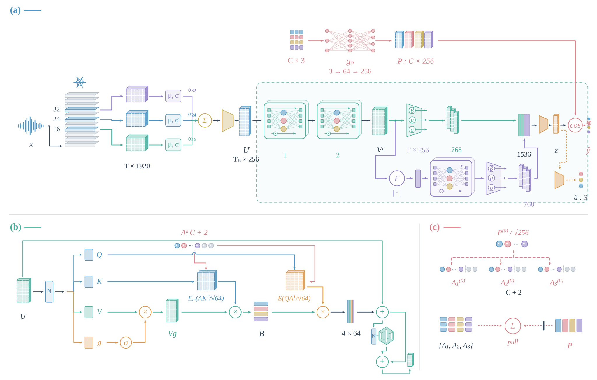

# AGAP-Net

Affect-anchored gated agent-prototype network for speech emotion recognition.

AGAP-Net combines frozen XLS-R representations with class prototypes derived from valence, arousal, and dominance (VAD) priors. The prototypes initialize the class-associated agents, guide them through an alignment objective, and classify the final utterance embedding.



## Model

1. Select XLS-R-2B layers 16, 24, and 32 and normalize their channels using training-fold statistics.
2. Learn a layer mixture and project the sequence from 1920 to 256 channels.
3. Apply two gated agent blocks. Each block uses four attention heads and `C + 2` agents for `C` emotion classes.
4. Pool the temporal sequence and process its normalized Fourier magnitudes with one further agent block.
5. Concatenate an attention summary, mean, and standard deviation from each branch; project the resulting 1536 channels to a 256-dimensional utterance embedding.
6. Classify by scaled cosine similarity against the VAD-derived prototypes. Soft class targets, VAD regression, and agent alignment train the readout jointly.

The two additional agents are initialized independently. With norm-based moment selection, attention continues to use every valid position. The spectral transform spans the padded batch time axis, so the prediction utilities preserve the checkpoint's batch size, frame budget, and padding rule.

## Installation

Python 3.10 or later is required. Install an appropriate [PyTorch build](https://pytorch.org/get-started/locally/) for your hardware, then:

```sh
git clone https://github.com/wyyy5111/AGAP-Net.git
cd AGAP-Net
python -m pip install -e ".[extract,dev]"
python -m pytest -q
```

The tests use small synthetic feature arrays and a randomly initialized tiny encoder; they do not download XLS-R weights or speech datasets. A recorded development environment is available in `requirements-tested.txt`.

## Prepare a manifest

Obtain the speech corpus under its own access conditions. Create one JSON object per utterance, following `examples/manifest.example.jsonl`:

```json
{"id":"utt_001","audio":"audio/utt_001.wav","label":"anger","group":"speaker_01"}
```

Audio paths are relative to the manifest file. IDs must be unique. Use speaker IDs as groups for speaker-independent evaluation, or session IDs for session-independent evaluation. Keep the intended corpus subset and annotation mapping explicit when preparing the manifest.

Supported class names are `anger`, `boredom`, `disgust`, `fear`, `happiness`, `neutral`, `sadness`, and `surprise`. Their fixed design priors are in `agapnet.data.VAD_PRIORS`.

## Extract frozen features

The encoder is [facebook/wav2vec2-xls-r-2b](https://huggingface.co/facebook/wav2vec2-xls-r-2b). Speech is converted to mono, resampled to 16 kHz, and standardized per utterance. Extraction stores the selected layer states in half precision.

```sh
agapnet-extract \
  --manifest data/emodb.jsonl \
  --output features/emodb \
  --device cuda \
  --batch-size 1
```

Use `--device cpu` or `--device mps` as appropriate. `--model` also accepts a local XLS-R-2B directory, and `--revision` can pin a Hugging Face model revision. The encoder weights are obtained separately and remain frozen.

The resulting cache contains `feats.npy`, `meta.json`, and `DONE`. Attention masks use **waveform sample lengths**. Metadata records valid sample counts, feature lengths, audio hashes, and encoder revision information. Existing caches with layers `[8, 16, 24, 32, 48]` can also be read; the model selects layers `[16, 24, 32]`.

## Train and evaluate

```sh
agapnet-train \
  --cache features/emodb \
  --config configs/emodb.json \
  --output runs/emodb \
  --device cuda
```

This command trains a separate model for every held-out group. To run one fold, add `--held-out speaker_01`. `--seed` and `--epochs` override the corresponding training settings.

The three configuration files supply the main AGAP-Net settings for EmoDB, CASIA, and BodEMODB. All three use 0.15 dropout in the utterance embedding. The BodEMODB configuration uses the upper half of vectors by norm for moment estimation. All use the complete temporal, spectral, and prototype computation.

Training uses AdamW, a fixed 100-epoch schedule, warmup and cosine decay, random feature crops, time masking, channel dropping, and feature noise. Fold moments are estimated from training utterances only. Evaluation uses the final exponential moving average of the parameters and no test-time shifts.

Each fold produces:

- `model.pt`: model weights, normalization statistics, label vocabulary, configurations, and provenance.
- `predictions.npz`: utterance IDs, probabilities, and labels in a common order.
- `metrics.json`: WA, UAR, macro-F1, parameter count, and configuration.

`summary.json` reports equal-fold means and population standard deviations in percent. Fold standard deviations describe variation across held-out groups. UAR excludes unrepresented classes; macro-F1 includes zero for a class with no true or predicted examples.

## Predict

From cached features:

```sh
agapnet-predict \
  --checkpoint runs/emodb/FOLD_DIRECTORY/model.pt \
  --cache features/emodb \
  --output runs/emodb/predictions.jsonl \
  --device cuda
```

The default group is the checkpoint's held-out group; `--group` selects another cached group. Replace `FOLD_DIRECTORY` with the directory printed by the training command.

From new audio, using the checkpoint's class vocabulary:

```sh
agapnet-predict \
  --checkpoint runs/emodb/FOLD_DIRECTORY/model.pt \
  --audio speech.wav \
  --output runs/emodb/new_audio.jsonl \
  --device cuda
```

Each JSONL row contains an utterance ID, predicted emotion, and probabilities indexed by class name. New audio requires the same frozen encoder weights; use `--encoder` and `--revision` to select them.

## Code and resources

The model and objective follow the project's AGAP-Net computation. The portable cache reader, checkpoint format, and command-line tools organize that computation for use outside the original workspace. The released extractor constructs sample-level masks; historical experiment caches remain tied to their recorded extraction provenance.

This repository provides the core implementation and its primary configurations. Corpus audio, extracted caches, historical experiment archives, and trained checkpoints are obtained or generated separately.

The source code is distributed under the [MIT license](LICENSE). Pretrained weights and datasets retain their respective terms; see [NOTICE](NOTICE). To cite the software, use [CITATION.cff](CITATION.cff).
